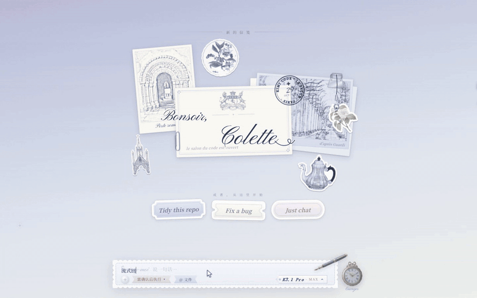
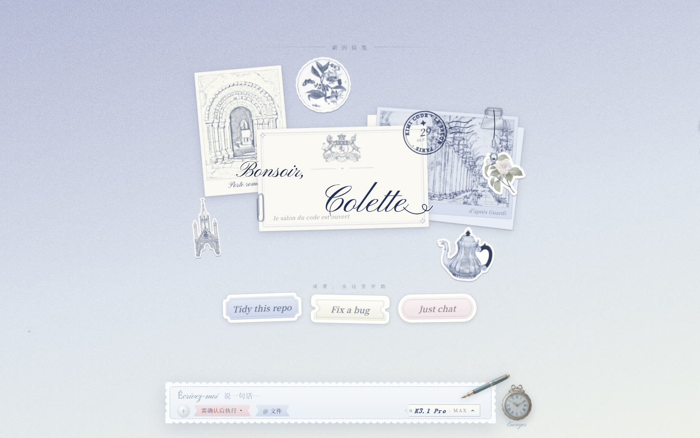
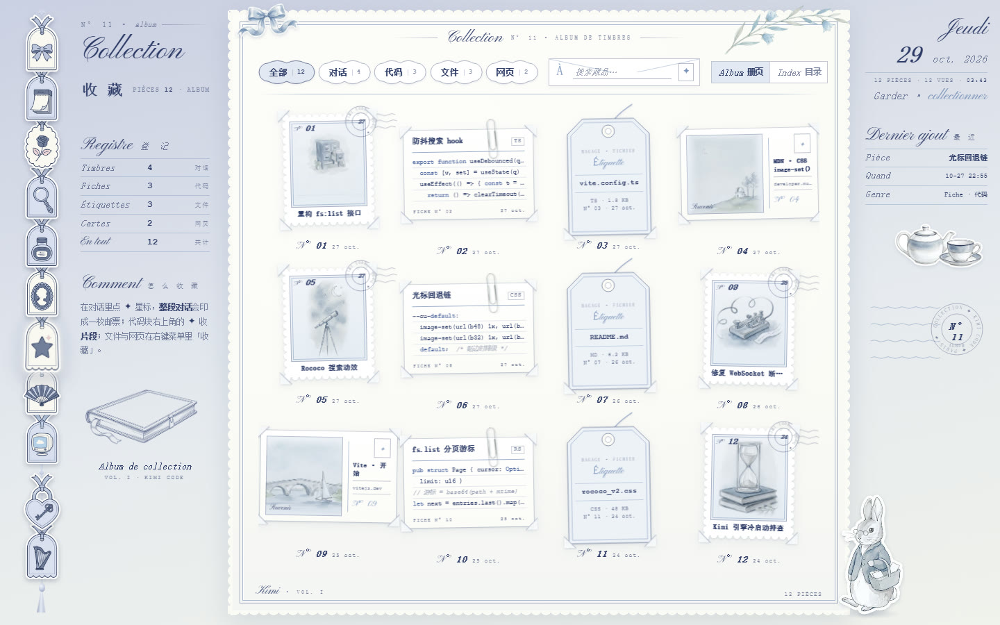
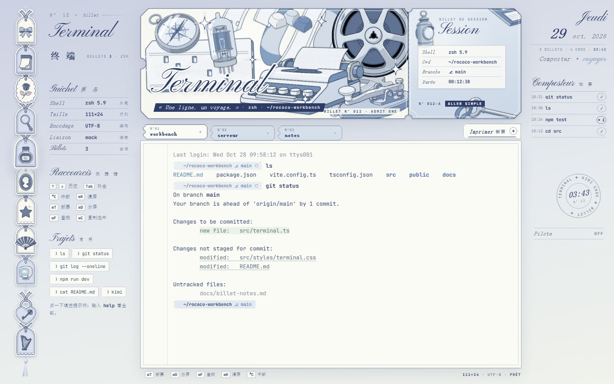

# Trianon

> 一套洛可可风格的 AI 编程助手桌面端**前端概念稿**：雾蓝、银蓝、奶白，信笺、吊牌、火漆和票根。
> 名字来自凡尔赛的小特里亚农宫（Petit Trianon）。

**⚠️ 非官方项目。** Trianon 是社区做的界面概念作品，和 Moonshot AI（月之暗面）没有任何关联，也没有得到它的认可或赞助。「Kimi」「Kimi Code」是 Moonshot AI 的名称；这里提到它们，只是为了说明这套界面是照着 Kimi Code 的使用场景设计的。仓库里没有官方 logo，也没有官方代码。

**▶ 在线试玩：<https://qimingjiu.github.io/Trianon/>**（地址末尾也可以加 `#empty`、`#play` 等场景名）




## 这是什么

- **只有前端。** 打开 `dist/trianon.html` 就是一个可以点的完整原型。它是一个单文件 HTML，所有随仓库分发的图片和自定义字体都内嵌在里面，系统字体只作为回退；打开时不联网，也不需要任何后端。
- 页面里的数据都是**内置的 mock**：示例对话、示例文件树、示例设置。人名、邮箱、路径都是虚构的。
- 包含这些页面：开场动画 Ouverture、空白页「新的信笺」、流式对话（工具卡、审批便条、提问卡、校样 diff、回合总结）、右侧卷宗「Dossier à Rubans」（Plan / Changes / Context）、会话抽屉、模型选择、文件面板和 @ 引用、设置、搜索、内置浏览器、收藏相册、终端票根，以及引擎的启动、断线和崩溃状态。
- 助手气泡右下角有一行很淡的签名水印 `for 妁妁 only`，这是作者的签名，特意保留了。

| 空白页 | 审批便条 | 设置 · 外观 |
|---|---|---|
|  |  |  |
| **收藏** | **终端** | **内置浏览器** |
|  |  |  |

## 打开 / 构建

直接打开：用 Chrome 或 Edge 打开 `dist/trianon.html`。在地址栏末尾加 `#` 和场景名，可以直接跳到某个状态，例如：

```
dist/trianon.html#empty          空白页
dist/trianon.html#end&rp-open    对话结束，卷宗展开
dist/trianon.html#approval       审批便条
dist/trianon.html#appearance     设置 · 外观
dist/trianon.html#collection     收藏
dist/trianon.html#terminal       终端
dist/trianon.html#browser        内置浏览器
dist/trianon.html#play           自动演示
```

从源码重新构建（需要 Python 3.9 或更高版本）：

```bash
pip install -r requirements.txt
python3 build.py          # 输出 dist/trianon.html
```

`build.py` 会进入 `src/` 运行 `build_rococo_v2.py`。构建只读 `src/` 下的文件，路径都是相对路径。同样的输入会得到逐字节相同的输出。

### 目录

```
build.py                 构建入口
src/
  build_rococo_v2.py     总装：把各页的 HTML/CSS/JS 和素材拼成一个文件
  build_rococo_v1.py     对话主线（会读 build_v11/12/13、build_sessions_v2、build_tools_v2、build_approval_v2 的定义部分）
  v8.html                最早的底稿（侧栏、信笺气泡、贴纸池），后续各层都叠在它上面
  *_v2.js / *.css        各页：engine_v2 引擎状态、files_v2 文件、settings_v3 设置、rococo_v2_* 搜索/浏览器/收藏/终端/导航/卷宗/开场
  r2v/ s2v/ s3v/ …       各页素材（图片、字体），来源见 ASSETS.md
dist/trianon.html        构建产物
docs/screenshots/        README 用的截图
licenses/fonts/          字体许可证全文
```

已知问题：`v8.html` 是一份预构建的底稿，它没有对应的源脚本。以后最好把它拆回独立的 CSS/JS。

## 接自己的后端：桥接 API（简版）

每一层都通过同一种很薄的桥接和外界通信，**不包含任何具体后端的代码**：

```js
// 后端 → 页面：推送事件
window.__eng.emit('engine.state', { state: 'ready' });

// 页面 → 后端：拦截请求。返回 false 就交回内置 mock 处理
window.__files.onRequest = (type, payload) => {
  if (type === 'workspace.list') { myBackend.list(payload).then(r => window.__files.emit('workspace.tree', r)); return true; }
  return false;
};
```

| 对象 | 方向 | 主要事件 / 请求 |
|---|---|---|
| `window.__eng` | 后端→页面 | `engine.state {state:'starting'\|'ready'\|'reconnecting'\|'stopping'\|'failed', …}`、`events.resync {restored?}`、`resync.failed {reason}` |
| `window.__files` | 双向 | 事件：`workspace.tree`、`file.content`、`git.status`、`fs.suggest`、`fs.search`、`agent.touched`；请求：`workspace.list`、`file.read`、`git.status`、`fs.suggest`、`fs.search`、`file.openIn/reveal/open/copyPath`、`workspace.pick/open` |
| `window.__set` | 双向 | 事件：`settings.load`、`settings.saved`、`settings.error`、`engine.health`、`engine.detected`；请求：`settings.save`、`engine.health.check`、`engine.restart`、`engine.detect`、`account.*`、`workspace.add/remove` |
| `window.__search` | 双向 | 事件：`search.recent`、`search.loading`、`search.results`、`search.error`；请求：`search.query`、`search.open`、`search.recentClear` |
| `window.__browser` | 双向 | 事件：`browser.tabs/navigate/loading/loaded/error/agentAction/console`；请求：`browser.open/back/forward/reload/newTab/closeTab/activateTab/takeover/screenshot/bounds/cover` |
| `window.__collection`、`window.__terminal` | 双向 | 同样的 `emit` / `onRequest` 模式 |

每个文件开头的注释里都写了字段的具体形状。

**还没接上的部分：** 对话主线（流式消息、工具调用、审批、提问、diff、Plan/Changes/Context）目前是一条写死的演示时间线（`rococo_v1.js` 里的 `SCRIPT`），还没有桥接。要接真实后端，先得把这一层改成按数据渲染。会话列表和模型选择现在也是静态的。如果你想对接一个公开协议（比如 Agent Client Protocol），可以从这里开始做。

## 许可

- 代码：MIT，见 `LICENSE`。
- 图片：AI 生成的图和程序生成的图按 CC0 提供；馆藏图来自公有领域或 CC0（The Met Open Access、Wikimedia Commons）。逐项说明见 `ASSETS.md`。
- 字体：SIL OFL 1.1 或 Apache-2.0，许可证全文在 `licenses/fonts/`。

---

## English

**Trianon** is an unofficial, front-end-only concept for a rococo-styled desktop UI for an AI coding agent (misty blue, silver and ivory; letters, hang tags, wax seals and ticket stubs). It is named after the Petit Trianon at Versailles.

**Not affiliated with, endorsed by, or sponsored by Moonshot AI.** "Kimi" and "Kimi Code" are names of Moonshot AI and are used here only to describe what the concept was designed around. No official logos or code are included.

- Live demo: <https://qimingjiu.github.io/Trianon/>
- `dist/trianon.html` is a self-contained, offline, clickable prototype. Every screen runs on built-in mock data, and all names, emails and paths in it are fictional.
- Build: `pip install -r requirements.txt && python3 build.py`. The build is reproducible: the same input gives byte-identical output.
- Backend bridge: every layer exposes `window.__xxx.emit(type, payload)` (backend → page) and `window.__xxx.onRequest = (type, payload) => …` (page → backend; return `false` to fall back to the mock). See the table above. The main conversation timeline is still a scripted demo and is not bridged yet.
- License: code MIT; images CC0 or public domain; fonts OFL/Apache. See `ASSETS.md`.
